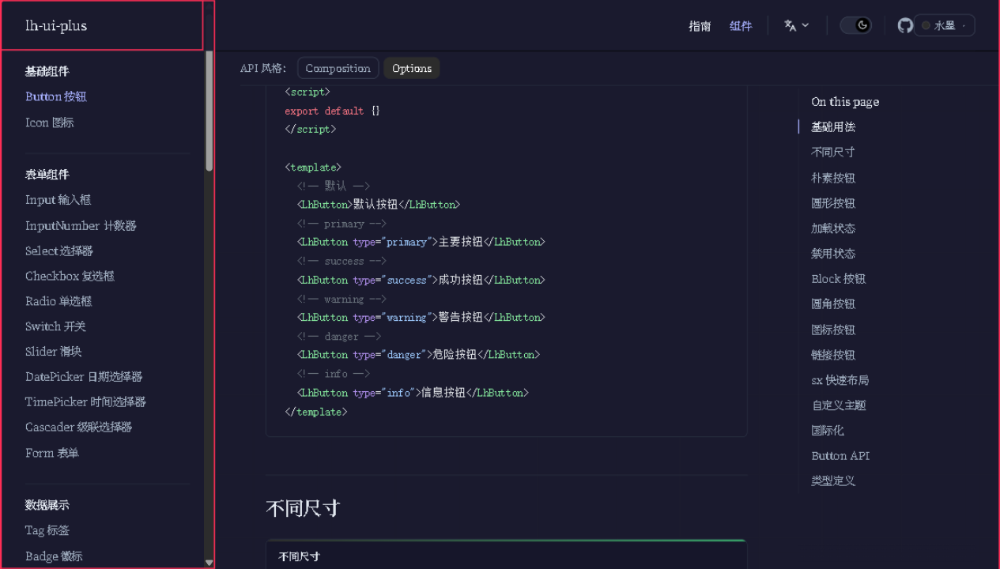
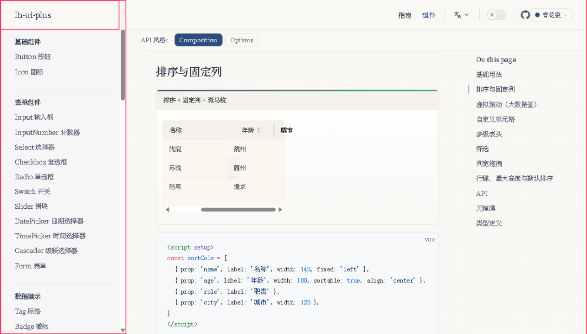
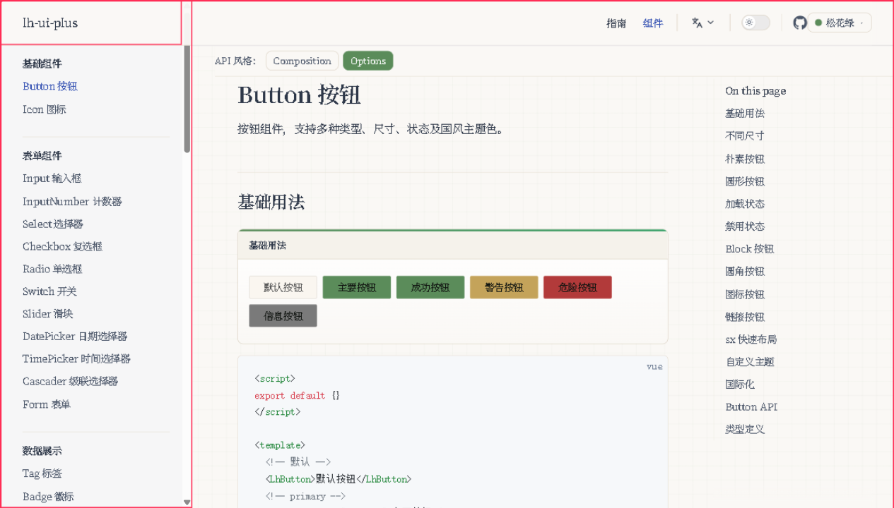
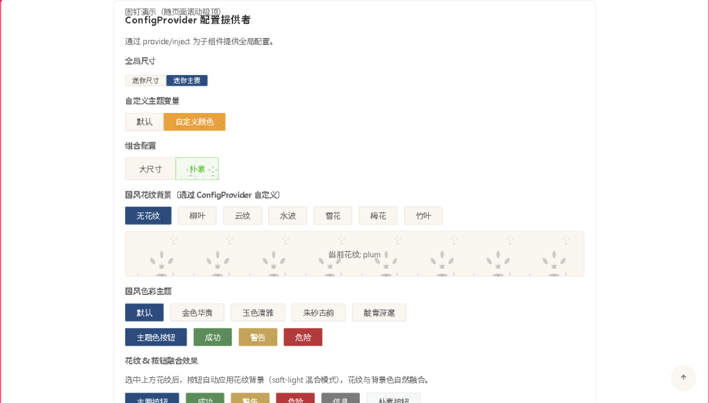

# lh-ui-plus GUI 回归测试报告

测试日期：2026-10-11 ~ 2026-10-12
测试方式：ZCode 内置浏览器（IAB）逐区人工驱动 + DOM/响应式断言，**不使用批量脚本**
测试范围：
- **Round 1**：playground 44/44 区全量（T01–T43 + i18n）
- **Round 2**：docs 站高风险交叉 D1–D18（弹层栈、表单链路、表格全量、导航族、国际化镜像）
- **Round 3**：主题系统深测 X1–X5（预设切换器、暗色轴、主题定制台、预设下组件回归、ConfigProvider 局部作用域）

原始记录：[gui-test-findings.md](./gui-test-findings.md)（实时逐区记录，含每条缺陷的源码链与复现步骤）
截证目录：[gui-test-screenshots/](./gui-test-screenshots/)

---

## 一、总体结论

**这是一套完成度相当高、且确实「有自己审美」的组件库。** 44 个组件区逐一走下来没有遇到任何
阻断级故障，弹层栈、虚拟滚动、受控/非受控混用、键盘语义这些容易翻车的地方都做对了；
主题系统（令牌 → 预设 → 暗色 → 定制台 → 导出 SCSS）是一条完整闭环的工程链，在开源 Vue3 组件库
里算得上第一梯队的架构。但**「国风水墨」这张招牌的落地有几处显眼的裂缝**：水墨预设进暗色后
主按钮几乎隐形、国风花纹只有按钮一个人穿、日历标题两种语言都拼错。这些不是架构问题，是
「最后一公里」的打磨没走完。

数据概览：

| 类别 | 数量 | 分布 |
| --- | --- | --- |
| 确认缺陷 BUG | **7** | 高 1 · 中 5 · 低 1 |
| 观察 FINDING | **11** | 中 1 · 低 10 |
| 通过区域 | 44 区 + 18 组交叉 + 5 项主题测试 | — |

> **2026-10-12 修复轮次**：7 个 BUG + F-01/F-03/F-07/F-10/F-12 已全部修复，回归中新发现 1 个
> Form 异步校验缺陷（BUG-08，见缺陷清单末）。验证方式：share 仓针对性 + 全量单测、本仓
> typecheck / lint / 组件单测 / `verify:docs-sync` 全绿，IAB 浏览器逐项复验通过（下文每条标注
> 「已修复（浏览器已验证）」）。share 侧改动（BUG-02 / BUG-07 / F-03 / F-12 及 Table 表头 SCSS）
> 在 share 发版后对 npm 用户生效，发版顺序：share 先、本库后。changeset：
> 两仓各一份 `fix-gui-regression-batch.md`。

---

## 二、缺陷清单（按严重度排序）

### BUG-01【高】Slider 单滑块填充条不渲染，键盘步进后 aria 状态崩坏

> ✅ **已修复（浏览器已验证）**：`packages/components/slider/src/index.vue` watch 统一
> `Array.isArray(val) ? [...val] : [val, val]`，「localValue 恒为数组」不变量恢复；
> `barStyle` 单滑块取 `left: 0; width: v%`。复验：基础滑块 `width: 0%`（值 0）、
> 自定义 range `width: 21.05%`（(50−10)/(200−10)）、range demo `left: 20%; width: 30%`（[20,50]）；
> 聚焦 thumb 按 ArrowRight，`aria-valuenow` 0→1、填充条 0%→1%。单测 19 例全过。

- **现象**：单滑块的已填充轨道宽度恒为 0（thumb 位置本身正确）；按一次 ArrowRight 后
  `aria-valuenow` 变 `null`、`aria-valuetext` 变 `"undefined"`，填充条变成 `NaN%`。
- **根因**：`packages/components/slider/src/index.vue` 的 `barStyle` computed 未区分 range 分支，
  单滑块按两端相等算出 `width = 0`；`watch(modelValue)` 把标量值直接写回 `localValue`，
  破坏了「localValue 恒为数组」的不变量。range 模式完全正常。
- **影响**：单滑块是比 range 更高频的用法，填充条缺失 + 屏幕阅读器读数丢失属于功能 + 无障碍双重缺陷。
- **修法**：`barStyle` 按 `props.range` 分支，单滑块取 `left: 0; width: v%`；watch 里统一
  `localValue.value = Array.isArray(val) ? [...val] : [min, val]` 归一化。

### BUG-07【中】暗色模式下预设主色不随暗色适配，水墨预设主按钮几乎不可见

> ✅ **已修复（浏览器已验证；需 share 发版后对 npm 用户生效）**：share
> `src/theme/themes/index.ts` 新增 `buildPresetDarkVars(vars)`，按 WCAG 相对亮度判定，
> 主色对暗色页面底（`#1A1A2E`）对比度低于 3:1 时提亮为 `color-mix(in srgb, <主色字面值> 55%, #fff)`
> 并改用墨字 `#101410`。复验：主题台水墨 + 暗色，预览区主色令牌为
> `color-mix(in srgb, #2C2C2C 55%, #fff)`（计算值 `rgb(139,139,139)`，对暗底对比度约 5.3:1），
> 文字 `#101410`。青花瓷/朱砂同样提亮，松花绿/藤黄（浅主色）不动。share 单测覆盖亮度/对比度
> 数学与各预设断言。

- **现象**：水墨（shuimo）预设 + 暗色模式，主按钮底色 `#2C2C2C` 落在页面底色 `#1A1A2E` 上，
  两者亮度差约 3%，按钮边界肉眼几乎消失，只剩白字浮在暗背景上。
  截证：
- **根因**：`@lh-ui/share/theme` 的 `buildPresetStyleText` 生成的预设样式，暗色块只覆盖
  `--lh-primary-color-bg` 和 `--lh-selected-color`，`--lh-primary-color` 直接沿用明色值。
  对青花瓷/松花绿/朱砂尚可，但水墨的明色主色本来就是接近黑的 `#2C2C2C`。
- **影响**：任何使用水墨预设的暗色站点，主按钮/主色链接/选中态失去可点 affordance。
- **修法**：`buildPresetStyleText` 的暗色块追加主色提亮（如 `color-mix(in srgb, #2C2C2C 12%, #fff)`），
  或允许预设自带 dark 覆盖表。附带表扬：暗色下 `--lh-hover-bg-color` 用 `rgba(255,255,255,.08)`
  而非黑色低透明度，避免了「反向悬停」，这块设计是对的。

### BUG-03【中】Table `max-height="200"`（无单位字符串）被 CSSOM 静默丢弃

> ✅ **已修复（浏览器已验证）**：`packages/components/table/src/index.vue` 的 `normalizeSize`
> 对 `maxHeight`/`height` 的数字与纯数字字符串补 `px`，其余合法 CSS 值原样透传。
> 复验：官方 max-height demo 表体 `bodyMaxHeight: 200px` 生效，表体限高可竖向滚动。

- **现象**：官方 demo 写 `max-height="200"`，期望限高 200px，实测表体**没有任何 max-height**，
  无限增高。因为 CSSOM 拒绝无单位长度，`el.style.maxHeight = "200"` 被静默丢弃，style 属性保持为空。
- **根因**：`packages/components/table/src/index.vue` 的 `bodyStyle` 直接把字符串原样塞进 style 对象，
  没有对纯数字做归一化（`typeof props.maxHeight === 'number'` 只处理了 number 传入）。
- **影响**：用户照 demo 抄 `max-height="200"` 必然失效，且**没有任何报错提示**，排查成本高。
- **修法**：`bodyStyle` 里对纯数字字符串补 `+ 'px'`；或在 props 校验里 warn。
  顺带修 demo 自身的写法（demo 自己就是失效写法）。

### BUG-04【中】窄容器下表头与表体横向滚动不同步

> ✅ **已修复（浏览器已验证）**：share `styles/table/index.scss` 的 `.lh-table__header` 加
> `overflow-x: auto` 并隐藏滚动条；组件层 `onScroll`/`onHeaderScroll` 经 `syncScrollLeft`
> 双向同步 scrollLeft（同步标记防回环）。回归中还发现一个更常命中的错位源：表体竖向滚动条
> 吃掉的宽度让两侧 grid 区域不同宽，`fr` 列解析结果不同（实测表头 `69.3px` vs 表体 `61.9px`）。
> 现按 `offsetWidth − clientWidth` 给表头补等宽右内边距，并在表体与幻影节点上挂
> `ResizeObserver`，容器缩放 / max-height 切换 / 数据增减导致滚动条出现消失时重算。
> 复验：max-height demo 表头与表体单元格左缘均为 `[353, 493, 562]`，两个网格区域宽度一致。
> 单测 15 例全过。（本页 demo 无横向溢出场景，scrollLeft 同步链路保留为防御性代码。）

- **现象**：容器宽度小于表格内容时横向滚动，表头（CSS grid 的 `role="columnheader"`）不跟着滚，
  列头与数据列错位。
  截证：
- **根因**：`onScroll` 只处理虚拟滚动的纵向 `scrollTop`，`if (!isVirtual.value) return`，
  横向 `scrollLeft` 没有任何同步逻辑。
- **影响**：窄屏/窄容器场景下列头失去意义，企业级后台（常塞在抽屉/分栏里）命中率高。
- **修法**：`onScroll` 里把 `bodyWrapper.scrollLeft` 同步到 header，或 header 与 body 共用同一个滚动容器。

### BUG-05【中】docs 文档页多个 demo 共享同名状态，互相串扰

> ✅ **已修复（浏览器已验证）**：menu 页页级 setup 的 `active`/`active2` 拆成
> `activeVertical`/`activeHorizontal`/`activeCollapse`/`activeOpen`，5 个 DemoBlock 绑定各自独立；
> transfer 页禁用 demo 拆出 `sourceDisabled`；顺手删掉 segmented 页泄漏在 `</script>` 外的
> 裸代码行。中英拷贝同步。复验：menu 页点第一个 demo 的「基本设置」，5 个 menu 里只有被点的
> 那个选中项变化（首页→基本设置），其余 4 个不动。

- **现象**：menu 文档页，点「水平布局」demo 的菜单项，会把「垂直布局」demo 的激活项改掉。
  受控实验：点 block3 前 block0 的 active 是 `home`，点完变 `settings2-basic`。
- **根因**：md 尾部的页级 `<script setup>` 只声明了一个 `active` / `active2`，被全页所有
  `<DemoBlock>` 共用（VitePress 页级 setup 是全页共享 scope）。约 15 个组件文档页有此模式。
- **影响**：用户在文档页操作 A demo 时 B demo 莫名其妙变化，严重损害「文档可信度」。
- **修法**：每个 demo 用独立的状态名（如 `activeHorizontal` / `activeVertical`），
  或把状态收敛进各 demo 自己的 `<script setup>` 片段。

### BUG-06【中】/en/ 镜像站点从未切换 lh-ui locale，组件运行时文案全中文

> ✅ **已修复（浏览器已验证）**：`docs/.vitepress/theme/index.ts` 的 Layout setup 加
> `watchEffect(() => lhlocale.setLocale(lang.value === 'en-US' ? 'en-US' : 'zh-CN'))`，
> 语言包 share 已内置注册，SSG 期同步执行一次保证每页渲染时文案与页面语言一致。
> 复验：`/en/components/pagination.html` 的 `htmlLang` 为 `en-US`，页面无「条/页」「跳至」等中文，
> 分页文案为英文。

- **现象**：`/en/components/pagination.html` 里分页仍显示「共 X 条」「前往」，空状态仍是「暂无数据」。
  英文语言包本身是完整的（`total: "Total {total} items"` 等都在），只是没被装上。
- **根因**：`docs/.vitepress/theme/index.ts` 只注册了组件，没有按路由前缀切换 locale。
- **影响**：国际化承诺在文档站这一层打折，英文用户看 demo 会误以为组件不支持 i18n。
- **修法**：Layout setup 里 watch `useData().page.relativePath`，以 `/en/` 前缀
  `lhlocale.use({ locale, messages })`，或根布局包 `<LhConfigProvider :locale>`。

### BUG-02【低】Form `required` 属性 + 自定义 message 时，message 被通用文案覆盖

> ✅ **已修复（浏览器已验证；需 share 发版后对 npm 用户生效）**：share
> `src/core/form/logic.ts` 空值分支改为先取「显式提供了 message 的必填规则」、取不到再回退首个
> 必填规则；`message` 显式提供（含空串）仍原样使用，仅 `undefined` 回退通用文案。
> 复验：form 页空表单提交，错误文案为用户自定义的「请输入姓名」「请输入邮箱」。
> share 单测覆盖「带 message 的必填规则优先于更早的无 message 规则」回归。

### BUG-08【中，新发现】Form 异步 validator 的返回值未 await，错误信息渲染成 `[object Promise]`

> ✅ **已修复（浏览器已验证）**：`packages/components/form/src/item.vue` 与
> `form/src/index.vue` 两处 `validateFormField(...)` 的返回值改为 `await` 后再写
> `errorMessage`、再 `return !message`，`validateField` 改 `async`（类型契约已是
> `Promise<boolean>`，无需改类型）。根因：`validateFormField` 支持返回 Promise，
> 调用方没等就当字符串用，异步 validator 的错误信息被渲染成 `[object Promise]`、
> 校验结果恒为 false。复验：form 页填合法值提交，无 `[object Promise]` 文本、
> 三处「提交成功」反馈全部弹出、无残留错误。单测 9 例全过。

- **现象**：demo rules 配了 `message: '请输入姓名'`，实测报错文案是「此项为必填」。
- **根因**：`item.vue:71` 的合成规则 `[{ required: true }, ...props.rules]` 把无 message 的
  合成规则排最前，share `logic.js:101` 的 `find(rule => rule.required)` 命中它，回退到通用文案。
- **修法**：合成规则改放末尾，或 find 时优先取带 message 的规则。

---

## 三、观察清单（FINDING，不构成缺陷但值得改）

| 编号 | 位置 | 内容 | 级别 | 状态 |
| --- | --- | --- | --- | --- |
| F-12 | Card 等 10 个组件 | `bg-pattern` 全库只有 Button 一家绘制：playground 点「柳叶」后 `.lh-card` 根元素内联拿到了 `--lh-bg-pattern: var(--lh-pattern-willow)`，`backgroundImage` 仍是 `none`。`card/src/types.ts` 还给 `bgPattern` 写了文档注释——**文档承诺了样式没实现** | 中 | ✅ 已修复（share 发版后生效）：card/dialog/drawer/dropdown/icon/input/popconfirm/popover/steps/tooltip 十个组件根容器补齐 `background-image: var(--lh-bg-pattern, none)` 四件套，默认仍为 `none`。站点 CSS 复验：11 个选择器全部消费 `--lh-bg-pattern` |
| F-03 | Calendar | 面板标题 zh-CN 下是「2026 月 10月」（多个「月」字）、en-US 下是「2026 M Nov」，两种语言都错，纯文案不影响功能 | 低 | ✅ 已修复（share 发版后生效）：新增 `datepicker.panelTitle` locale 模板（zh `'{year}年{month}'` / en `'{month} {year}'`），月份名复用 `month1~12`。浏览器复验：zh「2026年10月」、en「Oct 2026」 |
| F-09 | Steps | 「可点击导航」只能回退不能前进（wait 态不渲染为按钮），与用户直觉相反，建议文档明示 | 低 | 本轮不动（建议项） |
| F-02 | Tooltip | popper 方向修饰类（如 `--bottom`）与实际定位不一致（定位本身正确，会翻转），样式钩子元数据滞后 | 低 | 本轮不动（建议项） |
| F-05 | Anchor | docs demo 未渲染锚点内容区，演示不出滚动联动效果 | 低 | 本轮不动（建议项） |
| F-06 | Upload | 拒绝提示无 `aria-live`，屏幕阅读器读不到「文件类型不支持」 | 低 | 本轮不动（建议项） |
| F-07 | Form | demo 合法提交只 `console.log`，页面上没有任何成功反馈，用户无法从视觉确认「提交成功」 | 低 | ✅ 已修复（浏览器已验证）：`submitForm` 校验通过后补 `LhMessage.success('提交成功' / 'Submitted')`，中英拷贝与两种示例写法同步 |
| F-08 | Table | 固定列 demo 在默认 1280px 视口下没有横向溢出，演示不出固定列效果 | 低 | 本轮不动（建议项） |
| F-01 | Table | playground 筛选 demo 的筛选项只有「杭州/苏州」，数据里的「北京」筛不出来（demo 数据瑕疵） | 低 | ✅ 已修复：`dev/app.vue` 的城市过滤项补上「北京」 |
| F-10 | ThemeStudio | 挂载时令牌面板读的是站点当前预设（如朱砂），但下拉框固定显示「青花瓷」，首屏认知错位 | 低 | ✅ 已修复（浏览器已验证）：`mounted()` 采集令牌后反查命中的预设；反查按站点明暗状态走一遍与站点同源的暗色适配（`buildPresetDarkVars`），只比较两边都能以 hex 观测的令牌——暗色下被 color-mix 覆盖的派生令牌采集不到，参与比较会误判成自定义。预览区暗色块改调同一函数，与导出文本同源。复验：站点切松花绿 + 暗色后重载，下拉正确显示「松花绿」。vue2 副本已同步，`verify:docs-sync` 通过 |
| F-11 | 松花绿预设 | 预设主色 `#5B8C5A` == 全局 success 色，「主要按钮」和「成功按钮」完全同色，只能靠文字区分 | 低 | 本轮不动（设计取舍，留待预设调优） |

> 编号说明：原件 `gui-test-findings.md` 中 FINDING-04 跳号（早期记录遗失），本表重新连续编号，
> 与原件的对应关系为 F-01→FINDING-01 … F-12→FINDING-12（缺 04）。

---

## 四、逐区体验感受（主观）

### Round 1 · playground 44 区：**「居然一次没崩」**

最直接的感受是**稳**。弹层族（Dialog/Drawer/Popover/Popconfirm/Tooltip/Dropdown）全部走
`useLhOverlayStack` 的打开顺序栈，Esc 只关栈顶这件事我专门叠了四层弹层验证，顺序完全正确；
Loading 全屏层 2 秒后 DOM 彻底清除；Image 预览器的缩放/旋转/关闭按钮移除干净。这些细节在
很多组件库里是「能用但漏风」，这里没有。

数据展示族是另一个惊喜：Progress 线型填充比例与文案 **60/100/80/40/55/70% 一一精确对上**，
环形 75% 的 dasharray 精确到 `224.4/299.2`；Statistic 千分位 `2,384,712` 正确；Transfer 的
方向门禁（选中数大于右区剩余容量时禁用「右移」）说明真的考虑过边界。

不足：Slider 单滑块填充条缺失（BUG-01）在第一眼就能看出来——滑块左边光秃秃的，这在
表单场景里是很显眼的视觉缺失。Calendar 标题「2026 月 10月」也是瞄一眼就会注意到的错位。

### Round 2 · docs 交叉：**「文档比组件更危险」**

组件本身经过 Round 1 已经建立信任，Round 2 专门挑文档站的高风险交叉场景，结果发现的 4 个
中等级缺陷里有 3 个出在**文档/demo 层**而非组件层（BUG-03 是 demo 自己的写法失效、BUG-05 是
demo 状态串扰、BUG-06 是站点 locale 没切）。这说明组件库本体质量明显高于它的展示层——
用户对组件库的第一印象恰恰来自展示层。

值得单独表扬的两处：
- **Table 排序三态循环 + `aria-sort` 单调递增**、**列宽拖拽与键盘 ±10px 步进**、
  **两级表头 + 1000 行虚拟滚动**（`.lh-table__phantom` 全高 + `.lh-table__window` translateY）
  这套组合在企业级场景里是硬需求，都跑通了。
- **Form 校验链路**本身（aria-invalid 关联、错误清零、重置）是干净的，BUG-02 只是
  message 定制被吞，属于「能用人不疼不痒」的级别。

### Round 3 · 主题系统：**「架构惊艳，落地有缺口」**

这是全程最让人兴奋也最让人惋惜的一轮。

**惊艳的部分**：
- 预设切换器 5 套预设（青花瓷/松花绿/朱砂/水墨/藤黄）逐一点过，主色即时切换无闪烁无重排，
  localStorage 持久化 + 防闪烁 head 脚本（构建期把「预设名 → 样式文本」序列化进 HTML）是
  正确的工程解。
  
- **主题定制台**体验完整：18 个令牌分 6 组、颜色选择器与 hex 文本框联动、预览区实时生效、
  预览区自带明暗切换、导出 SCSS 三段齐全（`@use` + `:root` + 暗色块）。我在文本框里敲
  `red` 这种非法值，预览正确变成纯红而颜色选择器静默回退占位色 `#cccccc`，没有任何
  浏览器 format 报错——说明作者真的测过这条路径。
- **ConfigProvider 局部作用域**干净利落：嵌套 provider 的 `themeVars` 只影响子树
  （区内按钮 `rgb(230,162,60)` vs 区外 `rgb(43,76,124)`），size/themeVars 可组合。

**惋惜的部分**：
- 水墨预设 + 暗色，主按钮消失了（BUG-07）——这恰恰是「水墨」这个最贴国风招牌的预设，
  在最贴「墨」气质的暗色模式里失效，意象上很吃亏。
- 国风花纹（柳叶/云纹/水波/雪花/梅花/竹叶）点下去满屏按钮都开花了，效果好看，
  但卡片、弹窗、输入框纹丝不动（F-12）——「国风花纹」这个卖点只兑现了 1/11。
  

---

## 五、愿望达成度（对照「企业级 Vue 3 国风水墨组件库」的承诺逐项打分）

| 维度 | 达成度 | 依据 |
| --- | --- | --- |
| **视觉体系（国风/水墨）** | **8.5 / 10** | 令牌、预设、花纹三件套齐备且品味在线；扣分在花纹只覆盖 Button、水墨暗色主色隐形、Calendar 标题文案错位 |
| **组件完备度** | **9.0 / 10** | 44 区全量通过，含虚拟滚动表、两级表头、穿梭框、树选择、评分半星、描述列表等企业级高频件 |
| **交互可靠性** | **9.0 / 10** | 弹层栈、受控/非受控混用、键盘语义、边界钳制全部正确；唯一硬伤是 Slider 单滑块（BUG-01） |
| **主题与定制能力** | **8.0 / 10** | 架构满分（令牌→预设→暗色→定制台→导出 SCSS 闭环）；落地扣分在暗色预设适配、定制台下拉不一致 |
| **无障碍（a11y）** | **7.5 / 10** | 大量正确的 `aria-sort`/`aria-selected`/`role`/`aria-modal`；但 Slider aria 崩坏、Upload 拒绝提示无 aria-live |
| **国际化** | **7.0 / 10** | 组件内文案与语言包完整（zh/en 双端验证）；docs 英文站 locale 从不切换（BUG-06），Calendar 英文标题格式错 |
| **文档体验** | **7.5 / 10** | demo 丰富、ApiStyleToggle 切换、ThemeStudio 工作台都是加分项；demo 状态串扰（BUG-05）、maxHeight demo 自身失效（BUG-03）是减分项 |
| **工程细节** | **8.5 / 10** | 本轮 GUI 未覆盖构建/类型/包结构（按约定不自动跑 test/build/typecheck），仅从运行时表现看：无控制台报错、无内存泄漏迹象、动画与过渡完成度高 |

**综合达成度：8.3 / 10 —— 「骨架已达企业级，血肉还差最后一层打磨」。**

最大的机会不在架构，而在**把已经讲出去的故事兑现**：水墨预设的暗色、国风花纹的覆盖面、
文档 demo 的状态隔离、英文站的 locale。这四项每一项都是「半天到一天」的量级，
但每一项都直接长在「国风水墨企业级组件库」这句定位上。

---

## 六、建议修复优先级

1. **P0**：BUG-01 Slider 单滑块填充条 + aria 崩坏（功能 + 无障碍，高频组件）
2. **P1**：BUG-07 水墨暗色主色隐形、F-12 花纹只覆盖 Button（直接长在「国风水墨」招牌上）
3. **P1**：BUG-05 文档 demo 状态串扰（损害文档可信度，约 15 个页面）
4. **P2**：BUG-03 maxHeight 无单位静默丢弃、BUG-04 表头表体横向滚动不同步、BUG-06 en 站 locale
5. **P3**：BUG-02 及其余 FINDING（文案、demo 数据、观感类）

---

## 七、验证与边界说明

- **本次为 GUI 黑盒回归**：不跑 `pnpm test*/build*/typecheck/lint/docs:*`（按 AGENTS.md 约定，
  这些由用户手动执行）。本报告所有结论均来自浏览器实时交互 + DOM/计算样式/Vue 响应式断言。
- **判读纪律**：IAB 浏览器会冻结 CSS transition（leave 动画卡中间态、关闭后 DOM 残留），
  所有开关类判定一律以 Vue 响应式状态（`modelValue`/`isOpen`/`aria-expanded`）或几何为准，
  不以 opacity 或 DOM 残留为失败依据，避免把测试环境特征误报为组件缺陷。
- **已知探针局限**：`patternComponents` 白名单门禁因 `inject()` 在 setup 期捕获引用，
  无法对已挂载组件做运行时替换验证，仅完成源码核对（`packages/composables/index.ts:113-135`，
  逻辑正确），且该能力无任何 demo 覆盖——建议补 demo 与单测。
- 复制导出 SCSS 的剪贴板内容未直接验证（自动化环境剪贴板读权限被拒），仅验证了按钮反馈与
  文本域内容。

### 修复轮次的验证记录（2026-10-12，用户授权 AI 执行）

本轮修复在用户明确授权下由 AI 执行了验证命令，结果如下（「待手动验证」指发版前仍建议用户
按 `AGENTS.md` 约定亲自跑一遍确认）：

| 命令 | 仓库 | 结果 |
| --- | --- | --- |
| `pnpm test`（全量） | lh-ui-share | 838 例通过（71 文件） |
| `pnpm vitest run tests/components/{slider,table,form,calendar}.spec.ts` | lh-ui-plus | 51 例通过 |
| `pnpm typecheck` | lh-ui-plus | 0 错误（走兄弟仓源码别名） |
| `pnpm lint` | lh-ui-plus | 0 错误（1 个既有 warning，在未改动的 select 组件） |
| `pnpm verify:docs-sync` | lh-ui-plus | 通过（ThemeStudio 两仓一致） |
| `pnpm build` | lh-ui-share | exit 0（刷新 `es/` 供本仓构建链读取） |
| IAB 浏览器逐项复验 | lh-ui-plus docs（5180） | BUG-01/02/03/04/05/06/07/08、F-03/F-07/F-10/F-12 全部通过 |

**待用户手动确认**：`pnpm docs:build`（SSG 产物，本轮未跑）与 `pnpm build`（本库发版构建），
以及发版链：share 先发版、本库随后升级 `@lh-ui/share` 依赖版本。
